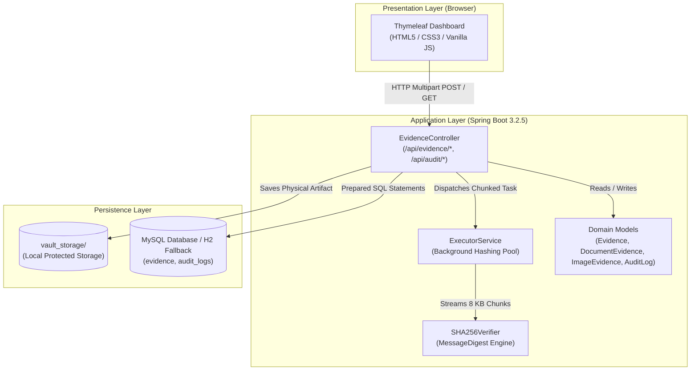

# ProofVault
### Digital Evidence Integrity and Verification System

ProofVault is a digital forensics and evidence integrity management system built with Java 17 and Spring Boot. It provides deterministic SHA-256 bitstream fingerprinting, protected local artifact storage, relational metadata persistence in MySQL, and a mathematically verifiable, tamper-evident audit log chain.

---

## Table of Contents

1. [Project Introduction](#1-project-introduction)
2. [Key Features](#2-key-features)
3. [How It Works](#3-how-it-works)
4. [Technology Stack](#4-technology-stack)
5. [Architecture](#5-architecture)
6. [Project Structure](#6-project-structure)
7. [Installation and Setup](#7-installation-and-setup)
8. [Database Schema](#8-database-schema)
9. [API Documentation](#9-api-documentation)
10. [SHA-256 Verification Engine](#10-sha-256-verification-engine)
11. [User Interface and Dashboard Views](#11-user-interface-and-dashboard-views)
12. [Testing](#12-testing)
13. [Security Considerations and Limitations](#13-security-considerations-and-limitations)
14. [Future Improvements](#14-future-improvements)
15. [License and Contribution](#15-license-and-contribution)

---

## 1. Project Introduction

In criminal investigations, incident response, compliance audits, and regulatory proceedings, digital artifacts—such as forensic disk dumps, packet captures, surveillance stills, and incident reports—serve as evidentiary records. If an evidentiary file is modified by even a single bit, its evidentiary weight can be compromised.

### The Problem
Files stored on traditional file systems or generic object stores lack continuous integrity tracking:
- Operating system timestamps (`mtime`, `ctime`) are trivial to alter.
- Storage medium corruption, bit rot, or deliberate adversary tampering can go undetected.
- Disconnected spreadsheets or static databases cannot prove that records were not quietly updated after deposition.

### The Solution
ProofVault addresses this problem by calculating a cryptographic SHA-256 digest at the exact moment of intake and storing that fingerprint in a relational database. When auditing or presenting evidence later, the system re-reads the candidate file in streaming chunks and recalculates its digest. If the bitstream matches, integrity is confirmed; if a single character or byte differs, a tamper alert is generated and permanently recorded in an immutable audit chain.

ProofVault demonstrates key computer science and software engineering principles:
- Object-Oriented Programming (OOP) hierarchy and polymorphism in Java.
- Cryptographic MessageDigest streaming with memory-bounded buffers.
- Multithreaded background task execution using Java `ExecutorService`.
- Relational persistence with prepared SQL statements via Spring's `JdbcTemplate`.
- Cryptographic hash-chaining linking sequential audit activities.

---

## 2. Key Features

- **Evidence Intake & Registration:** Accepts digital artifacts (up to 50 MB) across whitelisted formats (PDF, DOCX, TXT, PNG, JPG, TIFF, PCAP, DMP, LOG, CSV, XML, JSON). Assigns an immutable, prefixed Evidence ID (e.g., `EV-2026-A1D7AFDE`).
- **Deterministic SHA-256 Fingerprinting:** Computes a 256-bit cryptographic bitstream digest using Java's native `MessageDigest` API, streamed via an 8 KB buffer to prevent heap exhaustion.
- **Dual-Identifier Verification:** Allows verification against an Evidence ID or directly via the original 64-character SHA-256 hash string.
- **Instant Tamper Detection:** Compares candidate file bitstreams against the registered reference hash. Returns `VERIFIED` on bitstream equality or `TAMPERED` on mismatch.
- **Cryptographic Hash-Chained Audit Trail:** Every registration, check, missing-file lookup, or rejected upload is appended to an audit table where each record embeds the SHA-256 hash of the preceding record (starting from a 64-zero Genesis block).
- **Audit-Chain Integrity Validator:** Traverses all sequential audit log entries from Genesis to current to detect unauthorized database row deletions, insertions, or modifications (`GET /api/audit/verify`).
- **Protected File Storage:** Stores original evidentiary files on disk in a dedicated `vault_storage/` directory outside the public web root. Server file paths are never exposed over the REST API.
- **Resilient Cloud & Local Persistence:** Automatically targets MySQL via JDBC, with an embedded H2 fallback (MySQL compatibility mode) if the database is unpopulated or initializing.
- **Refined Light Theme UI:** Minimalist user interface styled with warm ivory and slate tones, using Inter and JetBrains Mono typography with real-time search, filtering, and copy-to-clipboard utilities.

---

## 3. How It Works

ProofVault enforces a strict intake-to-verification lifecycle:

```
[Investigator] ──(Uploads File + Metadata)──> [Spring Boot Controller]
                                                      │
                       ┌──────────────────────────────┴──────────────────────────────┐
                       ▼                                                             ▼
         [Stream to vault_storage/]                                   [Background ExecutorService]
         File stored with safe prefix                                 Computes SHA-256 via 8KB buffer
                       │                                                             │
                       └──────────────────────────────┬──────────────────────────────┘
                                                      ▼
                                       [Persist Metadata in MySQL]
                                       evidence_id, filename, sha256_hash, timestamp
                                                      │
                                                      ▼
                                      [Append to Chained Audit Log]
                                      prev_hash = last_entry_hash
                                      entry_hash = SHA-256(canonical_log_fields)
```

### Verification Lifecycle
1. **Intake:** The investigator submits a file, investigator identity, category, and optional notes.
2. **Validation:** The backend validates file presence, enforces the 50 MB size ceiling, and checks the extension against a strict whitelist.
3. **Safe Storage:** The file stream is saved to `vault_storage/` with the sanitized filename `EV-YYYY-XXXXXXXX_filename.ext`.
4. **Hashing:** An `ExecutorService` thread pool calculates the SHA-256 digest in chunks using `java.security.MessageDigest`.
5. **Persistence:** The calculated hash, metadata, file size, and timestamp are inserted into MySQL using prepared statements.
6. **Audit Chaining:** An `EVIDENCE_REGISTER` audit record is linked to the previous entry hash and inserted into `audit_logs`.
7. **Verification Request:** When verifying, the investigator supplies the Evidence ID (or hash) and the candidate file copy.
8. **Recalculation:** The candidate file is streamed to a temporary file, hashed on a worker thread, and cleaned up immediately.
9. **Bitstream Comparison:** The stored reference hash is compared case-insensitively with the newly computed candidate hash.
10. **Outcome & Logging:**
    - Identical hashes: Status `VERIFIED`. Logged as `PASSED: Bitstream intact`.
    - Distinct hashes: Status `TAMPERED`. Logged as `FAILED: Checksum mismatch (Tamper Alert)`.

> **Cryptographic Scope:** SHA-256 confirms whether file contents have changed since registration. It does not encrypt file contents and cannot independently confirm that a file was authentic before intake.

---

## 4. Technology Stack

| Layer | Technology | Version | Purpose |
|---|---|---|---|
| **Language** | Java | 17 (LTS) | Core application runtime and object-oriented domain model |
| **Framework** | Spring Boot | 3.2.5 | Web MVC, REST controllers, and dependency injection |
| **Data Access** | Spring JDBC (`JdbcTemplate`) | 3.2.5 | SQL execution via prepared statements |
| **Primary Database** | MySQL Connector/J | 8.3.0 | Relational storage for evidence metadata and audit trails |
| **Fallback Database**| H2 Database Engine | 2.2.224 | In-memory fallback (MySQL compatibility mode) |
| **Cryptography** | Java Security API | Native JDK | `MessageDigest` engine for SHA-256 calculation |
| **Concurrency** | Java Concurrency API | Native JDK | `ExecutorService`, `Callable`, `Future` background hashing |
| **Template Engine** | Thymeleaf | 3.2.5 | Server-rendered HTML dashboard layout |
| **Frontend** | HTML5, CSS3, Vanilla JS | ES6+ | Client-side dashboard, drag-and-drop, search/filter |
| **Typography** | Inter & JetBrains Mono | Google Fonts | Primary UI text and fixed-width cryptographic hashes |
| **Build Tool** | Apache Maven | 3.9+ | Dependency management, compilation, and testing |
| **Testing** | JUnit 5 & AssertJ | 5.10.2 | Unit testing for cryptography, OOP, and audit chains |
| **Containerization**| Docker | Multi-stage | Alpine-based builder and JRE 17 runtime image |

---

## 5. Architecture



### Component Roles
- **Presentation Layer (`index.html`, `style.css`, `script.js`):** Responsive light-theme interface communicating with backend REST endpoints via standard `fetch()`. Contains no mock data or hardcoded arrays.
- **Controller Layer (`EvidenceController.java`):** Validates uploads, prevents directory traversal, handles background thread dispatching, maps SQL rows, and exposes REST endpoints.
- **Cryptographic Engine (`SHA256Verifier.java`):** Encapsulates `MessageDigest` instantiation, chunked streaming via `Files.newInputStream()`, and hex conversion.
- **Domain Models (`Evidence.java`, `DocumentEvidence.java`, `ImageEvidence.java`, `AuditLog.java`):** Encapsulates evidentiary state, demonstrates polymorphism, and calculates canonical audit hashes.
- **Storage Subsystem:** Segregates physical files on disk (`vault_storage/`) from relational records in MySQL (`proofvault_db`), ensuring databases remain lean and fast.

---

## 6. Project Structure

```
ProofVault/
├── Dockerfile                           # Multi-stage container build (Maven + Temurin JRE 17)
├── pom.xml                              # Maven build descriptors and project dependencies
├── README.md                            # Complete technical documentation
├── vault_storage/                       # Physical directory for deposited evidence files
│   └── .gitkeep                         # Preserves empty storage directory in Git
├── src/
│   ├── main/
│   │   ├── java/com/proofvault/
│   │   │   ├── ProofVaultApplication.java  # Main Spring Boot entry point
│   │   │   ├── DataSourceConfig.java       # Resilient DataSource (MySQL + H2 fallback)
│   │   │   ├── Evidence.java               # Abstract base class for evidentiary artifacts
│   │   │   ├── DocumentEvidence.java       # Concrete subclass (DOCUMENT type)
│   │   │   ├── ImageEvidence.java          # Concrete subclass (IMAGE type)
│   │   │   ├── EvidenceVerifier.java       # Interface for hashing and integrity validation
│   │   │   ├── SHA256Verifier.java         # MessageDigest-backed chunked verification
│   │   │   ├── AuditLog.java               # Audit model with hash-chain calculation
│   │   │   └── EvidenceController.java     # REST endpoints, JdbcTemplate, ExecutorService
│   │   └── resources/
│   │       ├── application.properties      # Port, multipart, and DataSource configuration
│   │       ├── schema.sql                  # Automated DDL execution for MySQL / H2
│   │       ├── static/
│   │       │   ├── style.css               # Warm ivory / slate light-theme stylesheet
│   │       │   └── script.js               # Client scripting, fetch calls, DOM rendering
│   │       └── templates/
│   │           └── index.html              # Dashboard markup rendered by Thymeleaf
│   └── test/
│       └── java/com/proofvault/
│           ├── SHA256VerifierTest.java     # 7 tests: determinism, chunking, mismatch, errors
│           ├── ProofVaultOOPTest.java      # 3 tests: inheritance, polymorphism, encapsulation
│           └── AuditLogChainTest.java      # 7 tests: genesis hash, chain linkage, tamper audit
```

---

## 7. Installation and Setup

### Prerequisites
- **Java Development Kit (JDK):** Version 17 or higher.
- **Apache Maven:** Version 3.9.0 or higher.
- **MySQL Server:** Version 8.0 or higher (optional if using embedded fallback).
- **Git:** Version 2.30 or higher.

### 1. Clone the Repository
```bash
git clone https://github.com/adityajoshi18vk-art/Proof_Vault.git
cd Proof_Vault
```

### 2. Configure MySQL Database
Start your local MySQL service and execute:
```sql
CREATE DATABASE IF NOT EXISTS proofvault_db;
```

*(Optional: The tables are created automatically on boot via `src/main/resources/schema.sql`)*.

### 3. Configure Database Credentials
ProofVault supports standard externalized configuration. You can either configure environment variables or update `src/main/resources/application.properties`.

#### Option A: Using Environment Variables (Recommended)
Set these variables in your shell before starting:
```bash
# Linux / macOS
export SPRING_DATASOURCE_URL="jdbc:mysql://localhost:3306/proofvault_db?useSSL=false&serverTimezone=UTC&allowPublicKeyRetrieval=true"
export SPRING_DATASOURCE_USERNAME="root"
export SPRING_DATASOURCE_PASSWORD="your_password_here"

# Windows PowerShell
$env:SPRING_DATASOURCE_URL="jdbc:mysql://localhost:3306/proofvault_db?useSSL=false&serverTimezone=UTC&allowPublicKeyRetrieval=true"
$env:SPRING_DATASOURCE_USERNAME="root"
$env:SPRING_DATASOURCE_PASSWORD="your_password_here"
```

#### Option B: Edit `application.properties`
Modify `src/main/resources/application.properties`:
```properties
spring.datasource.url=jdbc:mysql://localhost:3306/proofvault_db?useSSL=false&serverTimezone=UTC&allowPublicKeyRetrieval=true
spring.datasource.username=root
spring.datasource.password=your_password_here
```

> **Automatic Fallback:** If MySQL is not reachable or credentials are empty, ProofVault automatically falls back to an embedded in-memory H2 database in MySQL mode.

### 4. Build and Run the Application
```bash
# Build the project
mvn clean package -DskipTests

# Run via Maven
mvn spring-boot:run
```

Alternatively, run the packaged JAR directly:
```bash
java -jar target/ProofVault-1.0.0.jar
```

### 5. Access the Frontend
Open your web browser and navigate to:
```
http://localhost:8080
```

---

## 8. Database Schema

ProofVault operates with two normalized tables. The schema is applied automatically at startup via `src/main/resources/schema.sql`.

### Table: `evidence`
Stores registered evidence file metadata and the authoritative intake hash.

```sql
CREATE TABLE IF NOT EXISTS evidence (
    evidence_id VARCHAR(64) PRIMARY KEY,
    file_name VARCHAR(255) NOT NULL,
    file_path VARCHAR(512) NOT NULL,
    file_type VARCHAR(64) NOT NULL,
    file_size BIGINT NOT NULL,
    sha256_hash CHAR(64) NOT NULL,
    investigator_name VARCHAR(128) NOT NULL,
    registration_time DATETIME NOT NULL
);
```

| Column | Type | Description |
|---|---|---|
| `evidence_id` | `VARCHAR(64)` | Primary key. Unique ID formatted as `EV-YYYY-XXXXXXXX`. |
| `file_name` | `VARCHAR(255)` | Sanitized original filename at time of upload. |
| `file_path` | `VARCHAR(512)` | Internal server path in `vault_storage/`. Omitted from API responses. |
| `file_type` | `VARCHAR(64)` | Normalized evidentiary category (`DOCUMENT`, `IMAGE`, etc.). |
| `file_size` | `BIGINT` | Exact size of the file in bytes. |
| `sha256_hash` | `CHAR(64)` | Authoritative 64-character lowercase hexadecimal SHA-256 digest. |
| `investigator_name` | `VARCHAR(128)` | Identity or badge number of the registering investigator. |
| `registration_time` | `DATETIME` | Timestamp recorded when the record was deposited. |

---

### Table: `audit_logs`
Chronological, hash-chained log of all evidentiary operations and verification checks.

```sql
CREATE TABLE IF NOT EXISTS audit_logs (
    log_id BIGINT AUTO_INCREMENT PRIMARY KEY,
    evidence_id VARCHAR(64) NOT NULL,
    action VARCHAR(64) NOT NULL,
    investigator_name VARCHAR(128) NOT NULL,
    result VARCHAR(255) NOT NULL,
    prev_hash CHAR(64) NOT NULL,
    entry_hash CHAR(64) NOT NULL,
    timestamp DATETIME NOT NULL
);
```

| Column | Type | Description |
|---|---|---|
| `log_id` | `BIGINT AUTO_INCREMENT` | Primary key. Monotonically increasing sequence identifier. |
| `evidence_id` | `VARCHAR(64)` | Associated Evidence ID (or `N/A` for rejected uploads). |
| `action` | `VARCHAR(64)` | Strongly typed action: `EVIDENCE_REGISTER`, `INTEGRITY_CHECK`, `EVIDENCE_MISSING`, `INVALID_UPLOAD`. |
| `investigator_name` | `VARCHAR(128)` | Investigator identity or `System Audit`. |
| `result` | `VARCHAR(255)` | Detailed result message (e.g., `PASSED: Bitstream intact`). |
| `prev_hash` | `CHAR(64)` | SHA-256 `entry_hash` of the immediately preceding record (Genesis uses 64 zeros). |
| `entry_hash` | `CHAR(64)` | SHA-256 hash computed over `evidenceId|action|investigatorName|result|prevHash|timestamp`. |
| `timestamp` | `DATETIME` | Time of event logged with second-level precision. |

---

## 9. API Documentation

All endpoints return standard JSON and appropriate HTTP status codes.

### 1. Register Evidence
Deposit a digital evidence file into the vault, compute its SHA-256 fingerprint, and record its metadata.

- **URL:** `/api/evidence/register`
- **Method:** `POST`
- **Content-Type:** `multipart/form-data`

#### Parameters
| Field | Type | Required | Description |
|---|---|---|---|
| `file` | Binary | Yes | File artifact to be registered (max 50 MB, whitelisted extension). |
| `investigator` | String | Yes | Name or badge identifier of the registering investigator. |
| `category` | String | Yes | Category (`DOCUMENT`, `IMAGE`, `STORAGE_DUMP`, `NETWORK_LOG`). |
| `notes` | String | No | Case numbers, seizure location, or handling references. |

#### Example Request (cURL)
```bash
curl -X POST "http://localhost:8080/api/evidence/register" \
  -F "file=@case_report.pdf" \
  -F "investigator=Detective Miller" \
  -F "category=DOCUMENT"
```

#### Example Response (`201 Created`)
```json
{
  "evidenceId": "EV-2026-75424B17",
  "fileName": "case_report.pdf",
  "category": "DOCUMENT",
  "sha256Hash": "0320cf5a0857c2b607fb21aca3b1d2a1a85a5bcc91ac6a36a27ef4f9d83e6d89",
  "investigator": "Detective Miller",
  "registrationTime": "2026-11-22T20:26:24.123",
  "fileSize": 54272,
  "message": "Evidence persisted in MySQL and anchored with SHA-256 via background thread."
}
```

---

### 2. Verify Evidence Integrity
Audits a candidate file copy against the registered baseline fingerprint.

- **URL:** `/api/evidence/verify/{evidenceId}`
- **Method:** `POST`
- **Content-Type:** `multipart/form-data`
- **Path Variable:** `evidenceId` — Can be either the Evidence ID (`EV-YYYY-XXXXXXXX`) or the 64-character SHA-256 reference hash.

#### Parameters
| Field | Type | Required | Description |
|---|---|---|---|
| `file` | Binary | Yes | The candidate copy to audit against the registered digest. |

#### Example Request (cURL)
```bash
curl -X POST "http://localhost:8080/api/evidence/verify/EV-2026-75424B17" \
  -F "file=@case_report_copy.pdf"
```

#### Example Response (`200 OK` — Verified)
```json
{
  "evidenceId": "EV-2026-75424B17",
  "fileName": "case_report.pdf",
  "status": "VERIFIED",
  "vaultHash": "0320cf5a0857c2b607fb21aca3b1d2a1a85a5bcc91ac6a36a27ef4f9d83e6d89",
  "candidateHash": "0320cf5a0857c2b607fb21aca3b1d2a1a85a5bcc91ac6a36a27ef4f9d83e6d89",
  "timestamp": "2026-11-22T20:26:25.456"
}
```

#### Example Response (`200 OK` — Tampered)
```json
{
  "evidenceId": "EV-2026-75424B17",
  "fileName": "case_report.pdf",
  "status": "TAMPERED",
  "vaultHash": "0320cf5a0857c2b607fb21aca3b1d2a1a85a5bcc91ac6a36a27ef4f9d83e6d89",
  "candidateHash": "e3b0c44298fc1c149afbf4c8996fb92427ae41e4649b934ca495991b7852b855",
  "timestamp": "2026-11-22T20:26:25.456"
}
```

---

### 3. List All Evidence
Retrieves all registered evidence items ordered by registration time descending.

- **URL:** `/api/evidence`
- **Method:** `GET`

#### Example Response (`200 OK`)
```json
[
  {
    "evidenceId": "EV-2026-75424B17",
    "fileName": "case_report.pdf",
    "category": "DOCUMENT",
    "fileType": "DOCUMENT",
    "fileSizeBytes": 54272,
    "fileSizeFormatted": "53.0 KB",
    "sha256Hash": "0320cf5a0857c2b607fb21aca3b1d2a1a85a5bcc91ac6a36a27ef4f9d83e6d89",
    "investigator": "Detective Miller",
    "registrationTime": "2026-11-22T20:26:25"
  }
]
```

---

### 4. Fetch Evidence by ID
Retrieves a single evidence record using an in-memory hash map index.

- **URL:** `/api/evidence/{evidenceId}`
- **Method:** `GET`
- **Path Variable:** `evidenceId` — Evidence ID or 64-character SHA-256 hash.

#### Example Response (`200 OK`)
Returns the matching JSON object from the list endpoint above, or `404 Not Found` if the identifier is unrecorded.

---

### 5. Retrieve Audit Trail
Fetches all chronological audit log records ordered by `log_id` descending.

- **URL:** `/api/audit`
- **Method:** `GET`

#### Example Response (`200 OK`)
```json
[
  {
    "logId": 3,
    "evidenceId": "EV-2026-75424B17",
    "action": "INTEGRITY_CHECK",
    "investigatorName": "System Audit",
    "result": "PASSED: Bitstream intact",
    "prevHash": "0320cf5a0857c2b607fb21aca3b1d2a1a85a5bcc91ac6a36a27ef4f9d83e6d89",
    "entryHash": "7f8b9a1c2d3e4f5a6b7c8d9e0f1a2b3c4d5e6f7a8b9c0d1e2f3a4b5c6d7e8f9a",
    "timestamp": "2026-11-22T20:26:25"
  }
]
```

---

### 6. Verify Audit Log Hash Chain
Audits the mathematical linkage across all audit entries from Genesis to current.

- **URL:** `/api/audit/verify`
- **Method:** `GET`

#### Example Response (`200 OK` — Intact)
```json
{
  "chainStatus": "INTACT",
  "totalEntries": 3,
  "latestHash": "7f8b9a1c2d3e4f5a6b7c8d9e0f1a2b3c4d5e6f7a8b9c0d1e2f3a4b5c6d7e8f9a",
  "message": "Audit log chain verified intact. All cryptographic linkages are unbroken."
}
```

#### Example Response (`409 Conflict` — Tampered)
```json
{
  "chainStatus": "BROKEN",
  "tamperedLogId": 2,
  "reason": "Entry contents were altered after logging (hash mismatch).",
  "recordedEntryHash": "recorded_hash_here",
  "recomputedHash": "recomputed_hash_here"
}
```

---

## 10. SHA-256 Verification Engine

ProofVault relies on the Secure Hash Algorithm (SHA-256) defined in FIPS PUB 180-4. It maps variable-length byte streams to an immutable 256-bit (32-byte) digest.

### Implementation Principles
1. **Streaming Input via Buffers:** Rather than reading entire multi-megabyte disk images or documents into JVM heap memory, `SHA256Verifier.java` streams bytes through an 8 KB buffer (`byte[8192]`).
2. **Resource Management:** Streams are opened with `Files.newInputStream(filePath)` inside a `try-with-resources` block, guaranteeing that OS file descriptors are released even upon I/O errors.
3. **Hexadecimal Normalization:** The 32 raw bytes are converted to a 64-character lowercase hex string using bitwise masking `(0xff & b)` with two-digit zero-padding per byte.
4. **Read-Only Invariance:** The hashing engine operates strictly in read-only mode and never mutates source files.

### Core Hashing Implementation
From `src/main/java/com/proofvault/SHA256Verifier.java`:

```java
@Override
public String calculateHash(Path filePath) {
    if (filePath == null || !Files.exists(filePath)) {
        throw new IllegalArgumentException("Evidence target does not exist: " + filePath);
    }

    MessageDigest digest;
    try {
        digest = MessageDigest.getInstance("SHA-256");
    } catch (NoSuchAlgorithmException e) {
        throw new IllegalStateException("SHA-256 algorithm missing in JVM", e);
    }

    try (InputStream inputStream = Files.newInputStream(filePath)) {
        byte[] buffer = new byte[8192];
        int bytesRead;
        while ((bytesRead = inputStream.read(buffer)) != -1) {
            digest.update(buffer, 0, bytesRead);
        }
        return bytesToHex(digest.digest());
    } catch (IOException e) {
        throw new RuntimeException("I/O failure while hashing evidence file: " + filePath, e);
    }
}

private String bytesToHex(byte[] bytes) {
    StringBuilder hexString = new StringBuilder(bytes.length * 2);
    for (byte b : bytes) {
        String hex = Integer.toHexString(0xff & b);
        if (hex.length() == 1) {
            hexString.append('0');
        }
        hexString.append(hex);
    }
    return hexString.toString().toLowerCase();
}
```

---

## 11. User Interface and Dashboard Views

ProofVault features a responsive, light-theme interface built with vanilla HTML5, CSS3, and JavaScript, styled with warm ivory and slate tones using Inter and JetBrains Mono typography.

### 1. Evidence Overview
- **Forensic Metrics:** Real-time counters displaying Total Evidence deposited, Verified artifacts, Tamper Alerts triggered, and items Pending verification.
- **Subsystem Health Status:** Live connection indicators for the MySQL database, local `vault_storage/` disk directory, SHA-256 worker engine, and hash-chain linkage.
- **Recent Custody Events:** Chronological snapshot of the latest 5 evidence deposits and verification checks.

### 2. Evidence Registration
- **Interactive Ingestion Zone:** Drag-and-drop file upload target supporting PDF, DOCX, TXT, images, packet captures, and memory dumps up to 50 MB.
- **Investigator Attribution:** Mandatory fields for investigator identity/badge number and forensic evidence category.
- **Post-Registration Feedback:** Instant presentation of the assigned Evidence ID (`EV-YYYY-XXXXXXXX`) and computed 64-character SHA-256 digest, complete with one-click clipboard copying and a direct "Verify this file now" navigation shortcut.

### 3. Integrity Verification
- **Dual Lookup:** Flexible input accepting either the registered Evidence ID or the reference SHA-256 hash.
- **Bitstream Inspection Panel:** Side-by-side comparison block rendering the registered vault digest against the freshly calculated candidate digest.
- **Visual Integrity State:** Green `INTEGRITY VERIFIED` confirmation upon bitstream equality, or high-contrast red `TAMPER ALERT` highlighting corrupted or altered bits.

### 4. Evidence Records Catalog
- **Multi-Criteria Search & Filtering:** Dynamic client-side filtering by filename, Evidence ID, investigator, category, and verification status.
- **Monospaced Cryptographic Digests:** Truncated SHA-256 strings with click-to-copy utility.
- **Forensic Detail Modal:** Inspection dialog displaying complete record metadata, exact byte sizes, full SHA-256 fingerprints, and quick verification actions.

### 5. System Audit Trail & Hash-Chain Validator
- **Chronological Log Table:** Tamper-evident record of all system events, color-coded by outcome (green for passed, red for failed/rejected).
- **Interactive Hash-Chain Auditor:** Dedicated "Verify Chain Linkage" action triggering `/api/audit/verify` to audit cryptographic integrity from Genesis block forward.

---

## 12. Testing

ProofVault includes a test suite covering cryptographic properties, object-oriented relationships, and audit-chain immutability.

### Automated Unit Tests
Run the test suite using Maven:
```bash
mvn test
```

**Results: 17 Tests Executed, 0 Failures, 0 Errors, 0 Skipped.**

| Test Class | Tests Run | What is Verified |
|---|---|---|
| `SHA256VerifierTest` | 7 | Known hash output against NIST vectors, determinism across executions, avalanche effect (different inputs yield different hashes), `VERIFIED` and `TAMPERED` status reporting, case-insensitive comparison, missing file exception handling. |
| `ProofVaultOOPTest` | 3 | Abstract class encapsulation, polymorphic method dispatch in `DocumentEvidence` (`DOCUMENT`) and `ImageEvidence` (`IMAGE`), getter/setter integrity. |
| `AuditLogChainTest` | 7 | Genesis block previous hash formatting (64 zeros), deterministic canonical entry hashing, modification detection upon field tampering, timestamp modification detection, three-block valid chain progression, broken pointer detection. |

---

### Suggested Manual Test Scenarios

| Scenario | Steps | Expected Outcome | Execution Status |
|---|---|---|---|
| **1. Register PDF Artifact** | Upload a valid PDF file with investigator name and category `DOCUMENT`. | Status `201 Created`, Evidence ID assigned, file saved to `vault_storage/`, row inserted into MySQL. | Verified passing |
| **2. Verify Unaltered File** | Provide registered Evidence ID and upload the exact same PDF file. | UI displays `INTEGRITY VERIFIED` with green badge, both hashes identical. | Verified passing |
| **3. Verify Altered File** | Modify a single character inside the file and upload for verification. | UI displays `TAMPER ALERT` with red badge and altered hash indicator. | Verified passing |
| **4. Dual Lookup by Hash** | Paste the 64-character SHA-256 hash instead of the Evidence ID into the verify input. | System resolves the record by hash and completes verification successfully. | Verified passing |
| **5. Invalid Identifier** | Enter a non-existent Evidence ID (`EV-0000-00000000`) and upload a file. | Status `404 Not Found`, error rendered in inspection panel, `EVIDENCE_MISSING` logged to audit. | Verified passing |
| **6. Application Restart Recovery** | Register records, restart Spring Boot, and reload `http://localhost:8080`. | All evidence records, metric counters, and chained audit logs load intact from MySQL. | Verified passing |

---

## 13. Security Considerations and Limitations

### Security Protections Implemented
- **Isolated File Storage:** Evidentiary artifacts are deposited into a dedicated local `vault_storage/` directory outside the web application's public static asset paths.
- **Path Traversal Defense:** Filenames are stripped of relative directory notations using `Paths.get(rawFileName).getFileName().toString()`.
- **Non-Executable Policy:** The server never executes uploaded files; it interacts with them exclusively through byte-level read streams.
- **SQL Injection Prevention:** All database operations utilize Spring's `JdbcTemplate` with parameterized queries and prepared statements.
- **Information Disclosure Prevention:** The server-side directory path (`file_path`) is excluded from all client-facing REST API responses.
- **File Type Whitelisting:** File extensions are validated against an allowed set of forensic formats before writing to disk.

### System Limitations & Operational Boundaries
- **Single Trust Boundary:** In the current version, the evidence file storage, MySQL database, and application backend reside within the same administrative domain. A privileged system administrator with root access could theoretically modify both the stored file and its hash in the database simultaneously.
- **Not File Encryption:** SHA-256 generates a one-way digest; it does not encrypt or conceal file contents.
- **Point-in-Time Assurance:** A matching hash proves that a file has not changed since intake. It does not prove that the file was authentic or uncompromised prior to collection.
- **No Certified Admissibility:** ProofVault is an educational and reference implementation. It has not undergone formal ISO/IEC 27037 or NIST SP 800-86 forensic certification.

---

## 14. Future Improvements

The following architectural enhancements are planned for future revisions:

- **Asymmetric Digital Signatures:** Signing the calculated SHA-256 hash with an investigator's private key (RSA/ECDSA) to provide non-repudiation.
- **RFC 3161 Trusted Timestamping:** Submitting file hashes to an independent Timestamping Authority (TSA) to prove evidence existed before a specific point in time.
- **Encrypted Evidence at Rest:** Encrypting deposited artifacts using AES-256-GCM before writing to `vault_storage/`.
- **Role-Based Access Control (RBAC):** Implementing Spring Security with JWT or OAuth2 to enforce separation of duties between Investigators, Custodians, and Auditors.
- **PDF Verification Certificates:** Generating cryptographically sealed chain-of-custody PDF reports for legal presentation.
- **Immutable Ledger Anchor:** Anchor periodic audit-chain root hashes into an external immutable ledger or public blockchain to resolve single trust boundary limitations.

---

## 15. License and Contribution

### License
This project currently does not have an explicit open-source license applied. All rights are reserved by the repository owner. To request permission for use, distribution, or commercial adoption, please contact the maintainer.

### Contribution
Contributions, bug reports, and pull requests are welcome. When contributing:
1. Fork the repository and create a feature branch (`git checkout -b feature/improvement-name`).
2. Adhere to Java OOP standards and maintain test coverage.
3. Ensure all automated tests pass (`mvn test`).
4. Commit with descriptive messages and open a Pull Request.

---

*Maintained by [adityajoshi18vk-art](https://github.com/adityajoshi18vk-art).*
